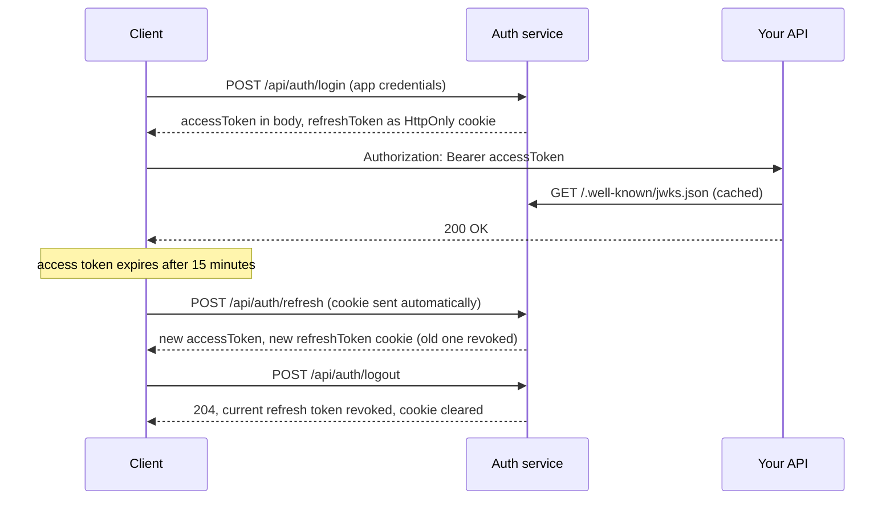

# dotnet-auth

A multi-tenant authentication service built with ASP.NET Core 9, ASP.NET Core Identity and PostgreSQL, with a React frontend.

Client applications register with the service and get an **App ID**. Their users then register and log in through it. Access tokens are JWTs signed with an RSA key (RS256). The public key is published as a JWKS, so any other service can verify tokens without sharing a secret.

## Features

- **Two kinds of application clients.** A *confidential* client (a server) gets an App ID and an API key; only an HMAC-SHA256 hash of the key is stored. A *public* client (a browser app) gets no key and is restricted to a list of allowed origins.
- **Per-app user accounts.** Every user belongs to one app, and the same email can register in several apps.
- **RS256 JWTs with a JWKS endpoint** at `/.well-known/jwks.json`. The signing key is loaded from config, so every replica shares it, and its `kid` is the key's thumbprint.
- **Per-app audiences.** Each app has an `aud` value (such as `notes-api`), so an app's API only accepts tokens issued for it. Tokens also carry `app_id` and role claims.
- **Short-lived access tokens, rotating refresh tokens.** Access tokens last 15 minutes. Refresh tokens last 7 days, live only in an `HttpOnly`, `Secure`, `SameSite=Strict` cookie, are stored hashed, and rotate on every refresh.
- **Refresh-token reuse detection.** Presenting a token that was already rotated revokes the whole login's token family.
- **Sessions.** Users can list their devices, see which one is current, and sign out any other device.
- **Brute-force protection.** Per-IP rate limits on login, register and refresh, and account lockout after 5 failed passwords.
- **React frontend (Argus)** with login, registration, profile and sessions pages.
- Unit and integration tests, GitHub Actions CI, Dockerfiles and a Kubernetes manifest.

## Tech stack

| Area | Technology |
| --- | --- |
| API | .NET 9, ASP.NET Core Web API, ASP.NET Core Identity |
| Data | EF Core 9 with Npgsql (PostgreSQL) |
| Tokens | `System.IdentityModel.Tokens.Jwt`, RSA 2048 / RS256 |
| Email | MailKit |
| Frontend | React 19, Vite, TypeScript, Zustand, TanStack Query, React Router, Axios, React Hook Form + Zod, Tailwind CSS + shadcn/ui |
| Tests | xUnit, SQLite in-memory, WebApplicationFactory + Testcontainers; Vitest, Testing Library, MSW |

## Repository layout

```
dotnet-auth/
├── auth.webapi/            # The auth service (see Project structure below)
├── auth.unitTest/          # Service-level tests over SQLite in-memory
├── auth.integrationTest/   # Full HTTP tests against a Postgres container (needs Docker)
├── frontend/               # React app (see frontend/README.md)
├── .github/workflows/ci.yml
├── Dockerfile              # API image
├── deployment-service.yml  # Kubernetes: API + frontend
└── dotnet-auth.sln
```

## Getting started

### Prerequisites

- .NET 9 SDK (or newer, with the ASP.NET Core 9 runtime)
- PostgreSQL
- Node.js 22.12+ for the frontend
- The EF Core CLI: `dotnet tool install --global dotnet-ef`
- Docker, only for the integration tests
- An SMTP account for welcome emails (optional; a failed email is logged and registration still succeeds)

### Configure the API

Set secrets with [user secrets](https://learn.microsoft.com/aspnet/core/security/app-secrets), from `auth.webapi/`:

```bash
dotnet user-secrets set "ConnectionStrings:DefaultConnection" "Host=localhost;Database=auth;Username=postgres;Password=<password>"
dotnet user-secrets set "Security:ApiKeySalt" "<random string, e.g. openssl rand -base64 32>"
dotnet user-secrets set "Security:AdminApiKey" "<random string>"
dotnet user-secrets set "EmailSettings:From" "you@example.com"
dotnet user-secrets set "EmailSettings:Username" "you@example.com"
dotnet user-secrets set "EmailSettings:Password" "<SMTP or app password>"
```

All settings:

| Key | Required | Notes |
| --- | --- | --- |
| `ConnectionStrings:DefaultConnection` | Yes | PostgreSQL connection string |
| `Security:ApiKeySalt` | Yes | HMAC key for API key hashes. Changing it invalidates every API key. |
| `Security:AdminApiKey` | For admin endpoints | Sent as `X-Admin-Key` to create apps. If unset, app creation is disabled. |
| `JWT:Issuer`, `JWT:Audience` | Yes (in `appsettings.json`) | `JWT:Audience` is this service's own audience |
| `JWT:PrivateKey` or `JWT:PrivateKeyPath` | Outside Development | PEM-encoded RSA private key, as text or a file path. In Development a key is generated into `auth.webapi/dev-signing-key.pem` (gitignored). |
| `EmailSettings:*` | Yes | `From`, `Username`, `Password`, plus `SmtpServer` and `Port` from `appsettings.json` |
| `Cors:AllowedOrigins` | No | Only needed when a browser calls the API from another origin. Defaults to `localhost:3000` and `localhost:5173`. |
| `RateLimiting:Credentials`, `RateLimiting:Refresh` | No | `PermitLimit` per `WindowSeconds`, per client IP. Defaults: 10/min for login and register together, 30/min for refresh. |
| `ForwardedHeaders:KnownNetworks` | Behind a proxy | CIDRs of proxies whose `X-Forwarded-For` is trusted, such as `10.0.0.0/8`. Without it, rate limits and session IPs see the proxy's address. |

In containers, use environment variables with `__` as the separator, such as `Security__ApiKeySalt` or `JWT__PrivateKey`.

### Run the API

```bash
cd auth.webapi
dotnet ef database update
dotnet run --launch-profile http     # http://localhost:5183, Swagger UI at /swagger
```

Swagger UI has fields for the `X-App-Id`, `X-Api-Key` and `X-Admin-Key` headers.

### Run the frontend

```bash
cd frontend
npm install
npm run dev                          # http://localhost:5173
```

The first time, open `http://localhost:5173/dev/apps`, create a **public** app with your admin key (the allowed origin is pre-filled), put the ID it shows into `frontend/.env.local` as `VITE_APP_ID=<id>`, and restart `npm run dev`. See [frontend/README.md](frontend/README.md) for how the frontend works.

### Try the API with curl

```bash
# 1. Create a confidential app (admin only). Save the id and rawApiKey.
curl -X POST http://localhost:5183/api/application-client \
  -H "Content-Type: application/json" -H "X-Admin-Key: <admin key>" \
  -d '{"name":"My App","audience":"my-app-api"}'

# 2. Register a user. The refresh cookie is saved to cookies.txt.
curl -X POST http://localhost:5183/api/auth/register -c cookies.txt \
  -H "Content-Type: application/json" -H "X-App-Id: <id>" -H "X-Api-Key: <rawApiKey>" \
  -d '{"fullName":"Jane Doe","email":"jane@example.com","city":"Colombo","password":"Passw0rd!"}'

# 3. Exchange the refresh cookie for a new access token.
curl -X POST http://localhost:5183/api/auth/refresh -b cookies.txt -c cookies.txt

# 4. Who am I, and where am I signed in?
curl http://localhost:5183/api/auth/me -H "Authorization: Bearer <accessToken>"
curl http://localhost:5183/api/auth/sessions -b cookies.txt -H "Authorization: Bearer <accessToken>"
```

[auth.webapi/auth.webapi.http](auth.webapi/auth.webapi.http) has the same requests for the VS Code REST Client or Visual Studio.

## How it works

### Application clients

`POST /api/application-client` (admin only, `X-Admin-Key`) creates an app:

- **Confidential** (default): the response includes a random 32-byte `rawApiKey`, shown once. The service stores `HMAC-SHA256(rawApiKey, Security:ApiKeySalt)`. Calls send `X-App-Id` and `X-Api-Key`.
- **Public** (`"isPublic": true`, with `allowedOrigins`): no key. Calls send `X-App-Id`, and the request's `Origin` header must be one of the allowed origins. Browsers set `Origin` themselves and scripts can't change it, so other websites can't use the App ID. Non-browser clients can fake `Origin`, so a public client is *identified*, not authenticated — the same trade-off as OAuth public clients.

Register, login and logout require app credentials. Each app also has an `audience` (defaults to its ID) that becomes the token's `aud`.

### Tokens

Access tokens are RS256 JWTs with a 15-minute lifetime and zero clock skew. Claims:

| Claim | Value |
| --- | --- |
| `nameid` | User ID |
| `email`, `unique_name` | Email and username |
| `role` | One per role (`User` for new accounts) |
| `app_id` | The user's application client |
| `aud` | The app's audience **and** this service's `JWT:Audience` |
| `jti`, `iat`, `exp`, `iss` | Standard |

A downstream API validates the signature with the JWKS, the issuer, the lifetime, and its own audience. Because the app's audience is in `aud`, an API for one app rejects tokens issued to another app's users.

> Tokens are **signed, not encrypted**. Anyone holding one can read its claims.

### Signing key

The key comes from `JWT:PrivateKey` (PEM text) or `JWT:PrivateKeyPath` (PEM file). In Development only, a key is generated on first run. Outside Development the service refuses to start without one, so replicas can't silently end up with different keys. The `kid` is the key's RFC 7638 thumbprint, so a new key always gets a new `kid`.

To create a key: `openssl genrsa -out signing-key.pem 2048`.

### Refresh tokens and sessions



- A refresh token is 64 random bytes. Only its SHA-256 hash is stored, with the user, app, User-Agent, IP and creation time.
- Each login starts a **token family**. Every refresh revokes the presented token, issues a new one in the same family, and records which token replaced it.
- **Reuse detection:** if a token that was already rotated comes back more than 30 seconds later, someone else has a copy, so every token in the family is revoked and both copies stop working. Within 30 seconds it's treated as a race (two tabs refreshing at once): that request fails, but the session survives.
- Concurrent refreshes with the same token are safe: the rotation is a conditional update, so exactly one wins.
- **Logout** revokes the current token, clears the cookie, and is idempotent. Other devices stay signed in.
- **Sessions** are the active tokens. `GET /api/auth/sessions` marks the caller's own with `isCurrent`, and `DELETE /api/auth/sessions/{id}` signs out another device.

### Registration and login

- Emails are matched case-insensitively (Identity's `NormalizedEmail`), and are unique per app.
- Passwords need 6+ characters, a digit, an uppercase letter, a lowercase letter and a symbol. If the password is rejected, the 400 response says which rules failed.
- After 5 wrong passwords the account is locked for 15 minutes (`423 Locked`).
- New users get the `User` role and a welcome email. If the email fails, the error is logged and registration still succeeds.

### Errors

Services throw `AppException` subclasses ([auth.webapi/Helpers/AppException .cs](auth.webapi/Helpers/AppException%20.cs)), and `GlobalExceptionMiddleware` returns `{ "message": "..." }` with the status from `ExceptionStatusCodeMapper`:

| Status | When |
| --- | --- |
| 400 | Validation failed, password rules not met, bad origin list |
| 401 | Wrong credentials, bad app credentials or origin, invalid/expired/revoked refresh token, missing or bad admin key |
| 404 | User or session not found |
| 409 | Email already registered in this app |
| 423 | Account locked after too many failed logins |
| 429 | Rate limit exceeded |
| 500 | Anything unexpected |

Debug builds add a `detail` field to 500 responses. Model validation errors use ASP.NET's standard problem-details format.

## API

| Method | Route | Requires | Description |
| --- | --- | --- | --- |
| POST | `/api/application-client` | `X-Admin-Key` | Creates an app. Body: `{ name, audience?, isPublic?, allowedOrigins? }` |
| POST | `/api/auth/register` | App credentials | Body: `{ fullName, email, city, password }` |
| POST | `/api/auth/login` | App credentials | Body: `{ email, password }` |
| POST | `/api/auth/refresh` | `refreshToken` cookie | Returns `{ accessToken }` and rotates the cookie |
| POST | `/api/auth/logout` | Bearer token, app credentials | Revokes the current session, clears the cookie. Returns 204. |
| GET | `/api/auth/me` | Bearer token | `{ id, fullName, userName, email, city, appId, roles }` |
| GET | `/api/auth/sessions` | Bearer token | Active sessions, with `isCurrent` when the cookie is sent |
| DELETE | `/api/auth/sessions/{id}` | Bearer token | Signs out another device. Returns 204. |
| GET | `/.well-known/jwks.json` | Nothing | Public signing key |
| GET | `/api/auth/test` | Nothing | Health check |

"App credentials" means `X-App-Id` plus `X-Api-Key` (confidential) or an allowed `Origin` (public). Full request and response examples are in [auth.webapi/Docs/API.md](auth.webapi/Docs/API.md).

## Tests

```bash
dotnet test auth.unitTest           # services over SQLite in-memory
dotnet test auth.integrationTest    # the real app over HTTP against a Postgres container (needs Docker)
cd frontend && npm test             # Vitest + Testing Library + MSW
```

The integration tests apply the real migrations to a fresh Postgres and cover the full flow (register → login → refresh → replay → logout → sessions), reuse detection, concurrent refreshes, public clients, lockout, rate limiting, and that a downstream API can validate tokens from the JWKS.

CI ([.github/workflows/ci.yml](.github/workflows/ci.yml)) builds everything, checks that the migrations match the model, and runs all three test suites plus the frontend lint and build.

### Migrations

The model snapshot is committed, so `dotnet ef migrations add <Name>` works as usual. Check for drift with `dotnet ef migrations has-pending-model-changes`.

## Docker and Kubernetes

```bash
# API, from the repository root
docker build -t dotnet-auth .
docker run -p 8080:8080 \
  -e ConnectionStrings__DefaultConnection="<connection string>" \
  -e Security__ApiKeySalt="<salt>" -e Security__AdminApiKey="<admin key>" \
  -e JWT__PrivateKey="$(cat signing-key.pem)" \
  -e EmailSettings__From=... -e EmailSettings__Username=... -e EmailSettings__Password=... \
  dotnet-auth

# Frontend: nginx serving the build and proxying /api to API_UPSTREAM
docker build -t dotnet-auth-frontend --build-arg VITE_APP_ID=<public app id> frontend
docker run -p 8081:8080 -e API_UPSTREAM=http://host.docker.internal:8080 dotnet-auth-frontend
```

[deployment-service.yml](deployment-service.yml) runs two API replicas and two frontend replicas in the `dotnet-authentication` namespace. The API reads its secrets from a Kubernetes secret named `dotnet-auth-secrets`; the comment at the top of the file has the `kubectl create secret` command. Every replica loads the same signing key from it.

```bash
kubectl create namespace dotnet-authentication
# create the dotnet-auth-secrets secret (see deployment-service.yml)
kubectl apply -f deployment-service.yml
```

Browsers only accept the `Secure` refresh cookie over HTTPS (except on `localhost`), so terminate TLS in front of the frontend. Serve the frontend and API from the same site (the frontend's nginx proxy does this): the cookie is `SameSite=Strict`, so it isn't sent across unrelated domains, including separate `*.vercel.app` subdomains.

## Project structure

```
auth.webapi/
├── Controllers/     # AccountController (auth + sessions), ApplicationClientController, JwskController (JWKS)
├── Data/            # ApplicationDbContext: Identity tables, per-app username index, seeded roles
├── DTO/             # Request and response models
├── Docs/API.md      # Endpoint reference
├── Extentions/      # Database, Identity, JWT, CORS, rate limiting, forwarded headers, Swagger
├── Filters/         # [RequireApplicationClient] and [RequireAdminKey]
├── Helpers/         # AppException types and the status-code map
├── Interfaces/      # Service contracts
├── Middleware/      # GlobalExceptionMiddleware
├── Migrations/      # EF Core migrations and model snapshot
├── Models/          # AppUser, ApplicationClient, RefreshToken
├── Services/        # AuthService, TokenService, SigningKeyService, ApplicationClientService,
│                    # AppScopedUserValidator, EmailService, ConfigurationHelper
└── Program.cs
```

### Data model

- **ApplicationClient:** `Id` (the App ID), `Name`, `ApiKeyHash` (null for public clients), `IsPublic`, `AllowedOrigins`, `Audience`, `CreatedAt`.
- **AppUser:** extends `IdentityUser` with `FullName`, `City` and `ApplicationClientId`. `(ApplicationClientId, NormalizedUserName)` is unique.
- **RefreshToken:** `TokenHash` (unique), `FamilyId`, `Created`, `Expires`, `IsRevoked`, `RevokedAt`, `ReplacedByTokenId`, `Device`, `IPAddress`, `UserId`, `ApplicationClientId`.

## Known limitations

- **No signing key rotation yet.** The JWKS publishes one key. Changing it invalidates every access token issued in the last 15 minutes.
- **Downstream services fetch the JWKS by hand.** There's no `/.well-known/openid-configuration`, so `options.Authority` can't be used.
- **No password reset or email confirmation.** Identity's token providers are registered but unused.
- **The welcome email is sent during the request**, so a slow SMTP server slows down registration.
- **Revoking a session doesn't revoke its access token.** JWTs are stateless, so a signed-out device can keep calling APIs until its current access token expires (at most 15 minutes).

## License

MIT. See [LICENSE](LICENSE).
