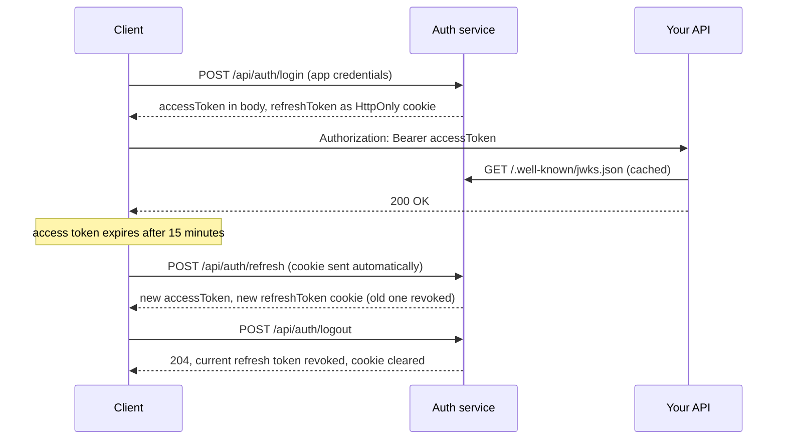

# dotnet-auth

A self-hosted authentication server for your projects, built with ASP.NET Core 9, ASP.NET Core Identity and PostgreSQL, with an admin console called **Argus**.

Run it once with Docker, sign in to Argus, and create an **app** for each project that needs sign-in. Each project's users register and log in through this server, and your project's API verifies their tokens with the published public key. No shared secrets, and no auth code to rewrite for every project.

## Quick start

You need Docker.

```bash
git clone https://github.com/Tharindu-s/dotnet-auth.git
cd dotnet-auth
cp .env.example .env          # set API_KEY_SALT, e.g. to the output of: openssl rand -base64 32
docker compose up -d
```

1. Open **Argus** at <http://localhost:8081>.
2. Sign in with `ADMIN_EMAIL` from `.env` (default `admin@argus.local`). The password is `ADMIN_PASSWORD`, or, if you left it empty, the generated one in the logs:
   ```bash
   docker compose logs api | grep "generated password"
   ```
3. Choose your own password. Argus asks for it on the first sign-in.
4. Click **New app**, and put the App ID (and API key, for a server app) in your project's config. The app's **Overview** tab has copy-paste code for signing users in and for validating tokens in your API.

The API is at <http://localhost:5183> (Swagger UI at `/swagger`). Data and the signing key live in Docker volumes, so they survive restarts.

**Locked out of Argus?** Set `RESET_ADMIN_PASSWORD=true` in `.env`, run `docker compose up -d`, sign in with the new password (`ADMIN_PASSWORD` or the generated one in the logs), then set it back to `false`.

## Features

- **Argus admin console.** Create, edit and delete apps, rotate API keys, turn sign-ups on or off, and see each app's users (search, lock, unlock, delete) and active sessions (revoke).
- **Two kinds of apps.** A *server* app (confidential client) gets an App ID and an API key; only an HMAC-SHA256 hash of the key is stored. A *browser* app (public client) gets no key and is restricted to a list of allowed origins.
- **Per-app user accounts.** Every user belongs to one app, and the same email can register in several apps.
- **RS256 JWTs with a JWKS endpoint** at `/.well-known/jwks.json`. Every replica shares one signing key, and its `kid` is the key's thumbprint.
- **Per-app audiences.** Each app has an `aud` value (such as `notes-api`), so an app's API only accepts tokens issued for it. Tokens also carry `app_id` and role claims.
- **Short-lived access tokens, rotating refresh tokens.** Access tokens last 15 minutes. Refresh tokens last 7 days, live only in an `HttpOnly`, `Secure`, `SameSite=Strict` cookie, are stored hashed, and rotate on every refresh.
- **Refresh-token reuse detection.** Presenting a token that was already rotated revokes the whole login's token family.
- **Sessions.** Users can list their devices, see which one is current, and sign out any other device.
- **Brute-force protection.** Per-IP rate limits on login, register, refresh and password changes, and account lockout after 5 failed passwords.
- Unit and integration tests, GitHub Actions CI, Docker Compose, Dockerfiles and a Kubernetes manifest.

## Tech stack

| Area | Technology |
| --- | --- |
| API | .NET 9, ASP.NET Core Web API, ASP.NET Core Identity |
| Data | EF Core 9 with Npgsql (PostgreSQL) |
| Tokens | `System.IdentityModel.Tokens.Jwt`, RSA 2048 / RS256 |
| Email | MailKit (optional) |
| Admin console | React 19, Vite, TypeScript, Zustand, TanStack Query, React Router, Axios, React Hook Form + Zod, Tailwind CSS + shadcn/ui |
| Tests | xUnit, SQLite in-memory, WebApplicationFactory + Testcontainers; Vitest, Testing Library, MSW |

## Repository layout

```
dotnet-auth/
├── auth.webapi/            # The auth service (see Project structure below)
├── auth.unitTest/          # Service-level tests over SQLite in-memory
├── auth.integrationTest/   # Full HTTP tests against a Postgres container (needs Docker)
├── frontend/               # Argus, the admin console (see frontend/README.md)
├── .github/workflows/ci.yml
├── docker-compose.yml      # Postgres + API + Argus
├── .env.example            # Settings for docker-compose.yml
├── Dockerfile              # API image
├── deployment-service.yml  # Kubernetes: API + Argus
└── dotnet-auth.sln
```

## Using it from your projects

Each app in Argus gives you:

| Value | Where it goes |
| --- | --- |
| **App ID** | `X-App-Id` header on register, login and logout |
| **API key** (server apps only) | `X-Api-Key` header on the same calls. Keep it on your server. |
| **Audience** | The `aud` your API validates |
| **Issuer** | The `iss` your API validates (`JWT_ISSUER` in `.env`) |
| **JWKS URL** | `http://localhost:5183/.well-known/jwks.json`, the public keys for verifying signatures |

A **server app** (your backend calls the auth server):

```bash
curl -X POST http://localhost:5183/api/auth/login \
  -H "Content-Type: application/json" \
  -H "X-App-Id: <app id>" -H "X-Api-Key: <api key>" \
  -d '{"email":"jane@example.com","password":"Passw0rd!"}'
```

A **browser app** calls it directly with `credentials: 'include'` and only `X-App-Id`. Add the page's origin (such as `http://localhost:5173`) to the app's allowed origins in Argus, and to `CORS_ORIGIN` in `.env` if the browser calls the API on another port. The refresh cookie is `SameSite=Strict`, so the app and the API must be on the same site (any `localhost` port counts).

**Validating tokens** in an ASP.NET Core API:

```csharp
var jwks = new JsonWebKeySet(await new HttpClient().GetStringAsync("http://localhost:5183/.well-known/jwks.json"));

builder.Services.AddAuthentication().AddJwtBearer(options =>
{
    options.TokenValidationParameters = new TokenValidationParameters
    {
        ValidIssuer = "http://localhost:5183",
        ValidAudience = "notes-api",
        IssuerSigningKeys = jwks.GetSigningKeys(),
    };
});
```

Other stacks do the same: verify the RS256 signature with the JWKS, then check `iss`, `aud`, `exp` and optionally `app_id`.

## Local development without Docker

### Prerequisites

- .NET 9 SDK (or newer, with the ASP.NET Core 9 runtime)
- PostgreSQL
- Node.js 22.12+ for the admin console
- The EF Core CLI: `dotnet tool install --global dotnet-ef`
- Docker, only for the integration tests

### Configure the API

Set secrets with [user secrets](https://learn.microsoft.com/aspnet/core/security/app-secrets), from `auth.webapi/`:

```bash
dotnet user-secrets set "ConnectionStrings:DefaultConnection" "Host=localhost;Database=auth;Username=postgres;Password=<password>"
dotnet user-secrets set "Security:ApiKeySalt" "<random string, e.g. openssl rand -base64 32>"
dotnet user-secrets set "Argus:AdminPassword" "<initial admin password>"   # optional, otherwise it's generated and logged
```

All settings:

| Key | Required | Notes |
| --- | --- | --- |
| `ConnectionStrings:DefaultConnection` | Yes | PostgreSQL connection string |
| `Security:ApiKeySalt` | Yes | HMAC key for API key hashes. Changing it invalidates every API key. |
| `JWT:Issuer`, `JWT:Audience` | Yes (in `appsettings.json`) | `JWT:Audience` is this service's own audience |
| `JWT:PrivateKey` or `JWT:PrivateKeyPath` | Outside Development | PEM-encoded RSA private key, as text or a file path. With `JWT:GenerateIfMissing=true`, a key is generated at `JWT:PrivateKeyPath` on first start (Docker Compose does this). In Development a key is generated into `auth.webapi/dev-signing-key.pem` (gitignored). |
| `Argus:AllowedOrigins` | Yes (in `appsettings.json`) | Where the admin console is served from. Applied to the Argus app on every start. Defaults to `localhost:5173` and `localhost:8081`. |
| `Argus:AdminEmail` | No | The first admin's email. Defaults to `admin@argus.local`. |
| `Argus:AdminPassword` | No | The first admin's initial password. If empty, one is generated and written to the log. Must pass the password rules. |
| `Argus:ResetAdminPassword` | No | Recovery: resets and unlocks the admin on start. Turn it off afterwards. |
| `Database:MigrateOnStartup` | No | Apply EF migrations when the service starts. On in Docker Compose. |
| `EmailSettings:*` | No | `From`, `Username`, `Password`, plus `SmtpServer` and `Port` from `appsettings.json`. Without them, emails are only logged. |
| `Cors:AllowedOrigins` | No | Browser apps that call the API from another origin. Defaults to `localhost:3000` and `localhost:5173`. |
| `RateLimiting:Credentials`, `RateLimiting:Refresh` | No | `PermitLimit` per `WindowSeconds`, per client IP. Defaults: 10/min for login, register and password changes together, 30/min for refresh. |
| `ForwardedHeaders:KnownNetworks` | Behind a proxy | CIDRs of proxies whose `X-Forwarded-For` is trusted, such as `10.0.0.0/8`. Without it, rate limits and session IPs see the proxy's address. |

In containers, use environment variables with `__` as the separator, such as `Security__ApiKeySalt` or `Argus__AdminEmail`.

### Run it

```bash
cd auth.webapi
dotnet ef database update
dotnet run --launch-profile http     # http://localhost:5183, Swagger UI at /swagger

cd ../frontend
npm install
npm run dev                          # Argus at http://localhost:5173
```

The first start creates the Argus app and the admin; the log shows the admin's email (and the password, if it was generated). See [frontend/README.md](frontend/README.md) for how the console works.

[auth.webapi/auth.webapi.http](auth.webapi/auth.webapi.http) has example requests for the VS Code REST Client or Visual Studio.

## How it works

### Argus, the admin console

On startup the service makes sure two things exist:

- **The Argus app**, a public client that the admin console signs in through. It's marked as the system app: it's hidden from the apps API, can't be edited or deleted there, and doesn't allow sign-ups. Its allowed origins come from `Argus:AllowedOrigins`.
- **The first admin**, a user of the Argus app with the `Admin` role, created only on the very first start. The admin must change the initial password before any admin endpoint works.

Admin endpoints (`/api/apps/...`) require a bearer token **and** check the database: the caller must be an Argus user with the `Admin` role, not locked out, with no pending password change. A role claim alone isn't enough, because every app's tokens are accepted by this service, so an `Admin` in one of your own apps would otherwise pass.

The console reads the Argus app ID from `GET /api/argus/config` when it loads, so nothing is baked into its build.

### Apps (application clients)

- **Server app / confidential** (default): creating it returns a random 32-byte `rawApiKey`, shown once. The service stores `HMAC-SHA256(rawApiKey, Security:ApiKeySalt)`. Calls send `X-App-Id` and `X-Api-Key`. Rotating the key replaces it immediately.
- **Browser app / public** (`"isPublic": true`, with `allowedOrigins`): no key. Calls send `X-App-Id`, and the request's `Origin` header must be one of the allowed origins. Browsers set `Origin` themselves and scripts can't change it, so other websites can't use the App ID. Non-browser clients can fake `Origin`, so a public client is *identified*, not authenticated — the same trade-off as OAuth public clients.

Register, login and logout require app credentials. Each app has an `audience` (defaults to its ID) that becomes the token's `aud`, and a `registrationEnabled` switch. Deleting an app deletes its users and sessions.

### Tokens

Access tokens are RS256 JWTs with a 15-minute lifetime and zero clock skew. Claims:

| Claim | Value |
| --- | --- |
| `nameid` | User ID |
| `email`, `unique_name` | Email and username |
| `role` | One per role (`User` for new accounts) |
| `app_id` | The user's app |
| `aud` | The app's audience **and** this service's `JWT:Audience` |
| `jti`, `iat`, `exp`, `iss` | Standard |

A downstream API validates the signature with the JWKS, the issuer, the lifetime, and its own audience. Because the app's audience is in `aud`, an API for one app rejects tokens issued to another app's users.

> Tokens are **signed, not encrypted**. Anyone holding one can read its claims.

### Signing key

The key comes from `JWT:PrivateKey` (PEM text) or `JWT:PrivateKeyPath` (PEM file, optionally generated on first start with `JWT:GenerateIfMissing`). In Development only, a key is generated automatically. Otherwise the service refuses to start without one, so replicas can't silently end up with different keys. The `kid` is the key's RFC 7638 thumbprint, so a new key always gets a new `kid`.

To create a key yourself: `openssl genrsa -out signing-key.pem 2048`.

### Refresh tokens and sessions



- A refresh token is 64 random bytes. Only its SHA-256 hash is stored, with the user, app, User-Agent, IP and creation time.
- Each login starts a **token family**. Every refresh revokes the presented token, issues a new one in the same family, and records which token replaced it.
- **Reuse detection:** if a token that was already rotated comes back more than 30 seconds later, someone else has a copy, so every token in the family is revoked and both copies stop working. Within 30 seconds it's treated as a race (two tabs refreshing at once): that request fails, but the session survives.
- Concurrent refreshes with the same token are safe: the rotation is a conditional update, so exactly one wins.
- **Logout** revokes the current token, clears the cookie, and is idempotent. Other devices stay signed in.
- **Sessions** are the active tokens. `GET /api/auth/sessions` marks the caller's own with `isCurrent`, and `DELETE /api/auth/sessions/{id}` signs out another device.
- **Changing the password** signs out every other session of that user. **Locking** a user (from Argus) signs them out everywhere.

### Registration and login

- Emails are matched case-insensitively (Identity's `NormalizedEmail`), and are unique per app.
- Passwords need 6+ characters, a digit, an uppercase letter, a lowercase letter and a symbol. If the password is rejected, the 400 response says which rules failed.
- After 5 wrong passwords the account is locked for 15 minutes (`423 Locked`). An admin can also lock it indefinitely.
- New users get the `User` role and a welcome email, if SMTP is configured. A failed email is logged and registration still succeeds.

### Errors

Services throw `AppException` subclasses ([auth.webapi/Helpers/AppException.cs](auth.webapi/Helpers/AppException.cs)), and `GlobalExceptionMiddleware` returns `{ "message": "..." }` with the status from `ExceptionStatusCodeMapper`:

| Status | When |
| --- | --- |
| 400 | Validation failed, password rules not met, wrong current password, bad origin list |
| 401 | Wrong credentials, bad app credentials or origin, invalid/expired/revoked refresh token, missing token |
| 403 | Not an Argus admin, admin password change pending, sign-ups turned off for the app |
| 404 | App, user or session not found |
| 409 | Email already registered in this app |
| 423 | Account locked |
| 429 | Rate limit exceeded |
| 500 | Anything unexpected |

Debug builds add a `detail` field to 500 responses. Model validation errors use ASP.NET's standard problem-details format.

## API

| Method | Route | Requires | Description |
| --- | --- | --- | --- |
| POST | `/api/auth/register` | App credentials | Body: `{ fullName, email, city, password }`. 403 if the app has sign-ups off. |
| POST | `/api/auth/login` | App credentials | Body: `{ email, password }` |
| POST | `/api/auth/refresh` | `refreshToken` cookie | Returns `{ accessToken }` and rotates the cookie |
| POST | `/api/auth/logout` | Bearer token, app credentials | Revokes the current session, clears the cookie. Returns 204. |
| GET | `/api/auth/me` | Bearer token | `{ id, fullName, userName, email, city, appId, roles, mustChangePassword }` |
| POST | `/api/auth/change-password` | Bearer token | Body: `{ currentPassword, newPassword }`. Signs out other sessions. Returns 204. |
| GET | `/api/auth/sessions` | Bearer token | Active sessions, with `isCurrent` when the cookie is sent |
| DELETE | `/api/auth/sessions/{id}` | Bearer token | Signs out another device. Returns 204. |
| GET | `/.well-known/jwks.json` | Nothing | Public signing key |
| GET | `/api/argus/config` | Nothing | `{ appId, issuer }` for the admin console |
| GET, POST | `/api/apps` | Argus admin | List apps, or create one. Body: `{ name, audience?, isPublic?, allowedOrigins?, registrationEnabled? }` |
| GET, PUT, DELETE | `/api/apps/{id}` | Argus admin | Read, update (`{ name, audience?, allowedOrigins?, registrationEnabled }`) or delete an app |
| POST | `/api/apps/{id}/rotate-key` | Argus admin | New API key, returned once |
| GET | `/api/apps/{id}/users?search=&page=&pageSize=` | Argus admin | Paged users |
| POST | `/api/apps/{id}/users/{userId}/lock`, `/unlock` | Argus admin | Lock (and sign out everywhere) or unlock |
| DELETE | `/api/apps/{id}/users/{userId}` | Argus admin | Delete a user |
| GET | `/api/apps/{id}/sessions?userId=` | Argus admin | Active sessions, newest first |
| DELETE | `/api/apps/{id}/sessions/{sessionId}` | Argus admin | Revoke a session |

"App credentials" means `X-App-Id` plus `X-Api-Key` (server app) or an allowed `Origin` (browser app). Full request and response examples are in [auth.webapi/Docs/API.md](auth.webapi/Docs/API.md).

## Tests

```bash
dotnet test auth.unitTest           # services over SQLite in-memory
dotnet test auth.integrationTest    # the real app over HTTP against a Postgres container (needs Docker)
cd frontend && npm test             # Vitest + Testing Library + MSW
```

The integration tests start the app the way Docker Compose does (migrations and the Argus setup on startup) and cover the full auth flow, reuse detection, concurrent refreshes, public clients, lockout, rate limiting, the admin access rules (including a forced password change and an `Admin` from another app being refused), the apps API end to end, and that a downstream API can validate tokens from the JWKS.

CI ([.github/workflows/ci.yml](.github/workflows/ci.yml)) builds everything, checks that the migrations match the model, and runs all three test suites plus the frontend lint and build.

### Migrations

The model snapshot is committed, so `dotnet ef migrations add <Name>` works as usual. Check for drift with `dotnet ef migrations has-pending-model-changes`.

## Kubernetes and other hosting

[deployment-service.yml](deployment-service.yml) runs two API replicas and two Argus replicas in the `dotnet-authentication` namespace. The API reads its secrets from a Kubernetes secret named `dotnet-auth-secrets`; the comment at the top of the file has the `kubectl create secret` command. Every replica loads the same signing key from it.

```bash
docker build -t <registry>/dotnet-auth .
docker build -t <registry>/dotnet-auth-frontend frontend
kubectl create namespace dotnet-authentication
# create the dotnet-auth-secrets secret (see deployment-service.yml)
kubectl apply -f deployment-service.yml
```

Browsers only accept the `Secure` refresh cookie over HTTPS (except on `localhost`), so terminate TLS in front of Argus and your apps. Set `Argus:AllowedOrigins` to the URL Argus is served from. Serve each browser app and the API from the same site: the cookie is `SameSite=Strict`, so it isn't sent across unrelated domains, including separate `*.vercel.app` subdomains.

## Project structure

```
auth.webapi/
├── Controllers/     # AccountController (auth, sessions, password), AppsController (admin console API),
│                    # ArgusController (console config), JwskController (JWKS)
├── Data/            # ApplicationDbContext: Identity tables, per-app username index, seeded roles
├── DTO/             # Request and response models
├── Docs/API.md      # Endpoint reference
├── Extentions/      # Database, Identity, JWT, CORS, rate limiting, forwarded headers, Argus, Swagger
├── Filters/         # [RequireApplicationClient] and [RequireArgusAdmin]
├── Helpers/         # AppException types and the status-code map
├── Interfaces/      # Service contracts
├── Middleware/      # GlobalExceptionMiddleware
├── Migrations/      # EF Core migrations and model snapshot
├── Models/          # AppUser, ApplicationClient, RefreshToken
├── Services/        # AuthService, TokenService, SigningKeyService, ApplicationClientService, AppUserAdminService,
│                    # ArgusBootstrapper, AppScopedUserValidator, EmailService, ConfigurationHelper
└── Program.cs
```

### Data model

- **ApplicationClient:** `Id` (the App ID), `Name`, `ApiKeyHash` (null for public clients), `IsPublic`, `AllowedOrigins`, `Audience`, `RegistrationEnabled`, `IsSystem` (true only for the Argus app), `CreatedAt`.
- **AppUser:** extends `IdentityUser` with `FullName`, `City`, `ApplicationClientId` and `MustChangePassword`. `(ApplicationClientId, NormalizedUserName)` is unique.
- **RefreshToken:** `TokenHash` (unique), `FamilyId`, `Created`, `Expires`, `IsRevoked`, `RevokedAt`, `ReplacedByTokenId`, `Device`, `IPAddress`, `UserId`, `ApplicationClientId`.

## Known limitations

- **One admin.** Only the first admin is created; there's no screen to add more yet.
- **No signing key rotation yet.** The JWKS publishes one key. Changing it invalidates every access token issued in the last 15 minutes.
- **Downstream services fetch the JWKS by hand.** There's no `/.well-known/openid-configuration`, so `options.Authority` can't be used.
- **No password reset or email confirmation** for your apps' users. Identity's token providers are registered but unused.
- **The welcome email is sent during the request**, so a slow SMTP server slows down registration.
- **Revoking a session, locking a user or deleting an app doesn't revoke access tokens already issued.** JWTs are stateless, so they keep working until they expire (at most 15 minutes).

## License

MIT. See [LICENSE](LICENSE).
